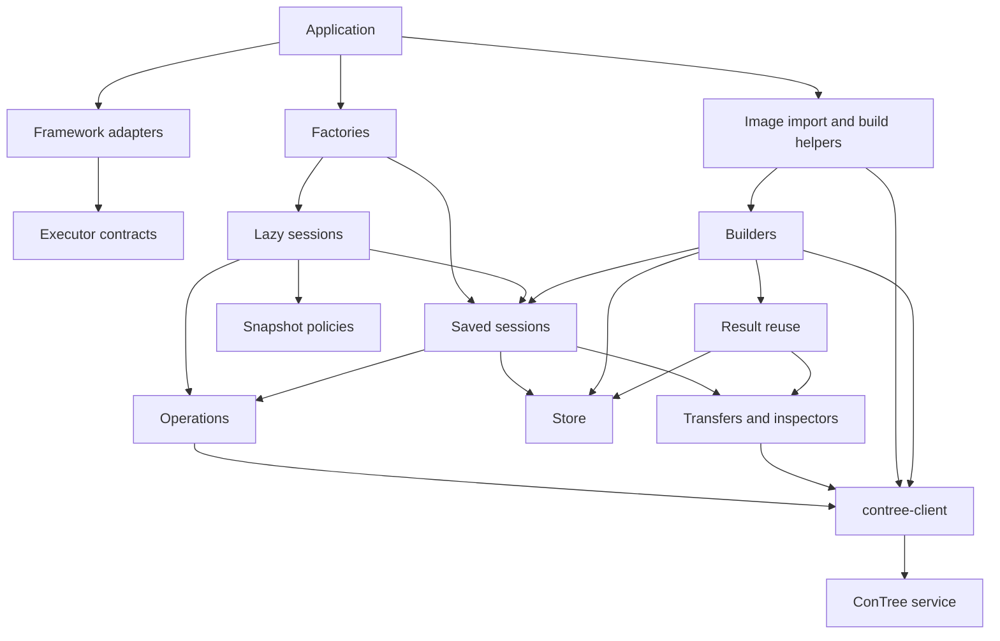

# Architecture and extension rules

This guide defines responsibilities, dependency boundaries, and extension contracts for the ConTree SDK. Use it to decide where new behavior belongs.

Locate definitions by class or function name before editing. Read their implementations, contract tests, and relevant guides. Obtain current signatures, defaults, limits, supported capabilities, and development commands from their authoritative sources. Keep this document focused on obligations that an implementation must preserve.

Report missing guidance or conflicts with the implementation or user instructions. Correct confirmed discrepancies; do not present uncertain behavior as an established contract.

## System boundaries

- The SDK owns execution orchestration, session history, snapshot coordination, file workflows, result reuse, builders, and framework adapters.
- `contree-client` owns the ConTree API contract, transports, authentication, profiles, retry behavior, wire models, and event decoding. Use its public interfaces.
- The ConTree service owns remote execution, filesystem images, uploaded content, and remote retention. A local reference does not retain a remote object.
- Applications select components and own the dependencies they supply. Components must not close borrowed dependencies.

The SDK does not require execution or storage on the consumer's machine. Files and Store backends can be remote. Apply this boundary to every existing SDK entity and extension. Local paths and SQLite are implementation choices, not requirements of the core contracts. Do not assume a shared host filesystem or durable local storage across consumers.

Every concrete implementation must document its resource location and lifetime in both public docstrings and user documentation. Include required local files, directories, and process memory. Distinguish optional local I/O from a deployment model that requires the consumer to remain on one machine.

When correctness depends on durable state stored on one machine, both documentation and docstrings must explicitly state the machine dependency and prohibit ephemeral storage in that configuration. Explain what is lost or becomes inaccessible when the machine or storage is replaced.

For each implementation-specific restriction, document a concrete way to remove the dependency. Name the replaceable sync/async contract and the public injection or configuration parameter in both documentation and docstrings. Provide a minimal replacement example in the documentation and reference it from the docstring. Show how to supply an alternative implementation without copying orchestration. A warning alone is insufficient. If the required extension point is missing, add it to the owning SDK component instead of making the restriction unavoidable.

Using a remote Store does not by itself make existing session or operation state shared between workers. Distributed coordination requires an explicit implementation and contract.

Consult the [client source](https://github.com/nebius/contree-client) for transport behavior and public client interfaces. The client is generated from the [OpenAPI specification](https://github.com/nebius/contree-client/blob/master/api/v1/spec.yaml), which defines API operations, schemas, and wire contracts. Check the SDK's selected client version before relying on behavior from the client's development branch.

ConTree executes commands in MicroVMs started from filesystem images. The SDK models a sandbox across operation and image transitions. Session history, the selected position, and local branch names belong to SDK components. Server links between operations and images describe provenance; they do not replace SDK session history.

Arrows below mean “uses.” They describe dependencies between components, not a file layout or a complete import graph.

Both session families implement executor contracts. A lazy session composes a saved session; it does not inherit its implementation. Store contracts remain independent of execution, builders, and transport.

## Extensibility contract

The SDK follows a simple pattern: abstract classes define the sync and async contracts; concrete classes implement them. For example, `SyncStore` and `AsyncStore` define storage contracts, while Memory and SQLite classes provide implementations.

Consumers depend on the matching contract, not a particular implementation. Accept compatible custom implementations and preserve supplied instances, subclasses, and configuration through factories and wrappers. A default implementation is a convenience, not a restriction.

Implementations must remain extensible through public, overridable behavior. Do not hide behavior or bypass an override merely to reduce the API surface. If changing one behavior requires copying orchestration, add the extension point to its owning component. Extensions preserve the contract; they need not copy the default mechanism or deployment choices.

Responsibility boundaries identify where to extend behavior. The hooks listed below are not an exhaustive whitelist. Any restriction on extension needs a concrete contract invariant and an explanation. Verify substitutability through normal public entry points using a custom implementation or subclass.

## Construction and resource ownership

### Connection and sandbox configuration

`ConnectionConfig` owns connection selection and client-construction options. `validate` rejects incompatible combinations, `resolve_profile` delegates credential resolution, and `open_sync`/`open_async` either open an owned client or return a supplied client.

Add connection-source validation here. Keep credential acquisition, profile parsing, retries, and HTTP behavior in `contree-client`. Preserve the distinction between supplying a configured client and supplying instructions to construct one.

`config_path` refers to configuration on the SDK process's host. Explicit connection parameters, a `Profile`, or a supplied client remove the need for that local file.

`SandboxConfig` owns component selection and argument routing. It validates matching executor, client, Store, and transfer modes. Its `connection` method constructs connection configuration; `session_arguments` separates factory-managed arguments from custom session arguments.

Add assembly options here and route them through `session_maker`. Do not execute commands, choose snapshots, or interpret stored history in configuration objects. Factory-managed dependencies must not be silently replaced by duplicate custom kwargs.

### Context classes

| Class                        | Responsibility                                                          | Extension obligation                                                                                                                                      |
| ---------------------------- | ----------------------------------------------------------------------- | --------------------------------------------------------------------------------------------------------------------------------------------------------- |
| `SyncSandboxSessionContext`  | Construct compatible synchronous components and manage owned resources. | Register cleanup before entering a custom session so partial entry failures can unwind. Finish the session before closing dependencies needed for saving. |
| `AsyncSandboxSessionContext` | Provide native async construction, session readiness, and cleanup.      | Join cleanup despite repeated cancellation. Preserve the original entry/body failure when cleanup also fails.                                             |
| `SandboxSessionContext`      | Compose the sync and async contexts behind one entry boundary.          | Construction performs no I/O. Select the mode at entry and reject reuse of the same context, including after failed entry.                                |

`session_maker(context_type, ...)` is the extension point for another context implementation accepting `SandboxConfig`. The convenience factories delegate to it.

`session_type` is a class, not a mode label. Preserve the supplied subclass and its return type. Validate mode compatibility before constructing resources. A lazy subclass receives a saved session; another executor class receives the client and session constructor arguments. `session_kwargs` configures the selected class. Assemble components explicitly when a custom lazy wrapper also needs a custom saved-session base.

Factory contexts close owned clients and Stores and exit sessions that implement the matching context protocol. Supplied clients, Stores, and transfers remain caller-owned. Saved session objects do not provide automatic cleanup for directly constructed dependencies. Lazy wrappers borrow their saved session and its dependencies.

Image import/build helpers use the same connection and ownership rules. Their result is a ConTree image reference, not an open session. Keep registry-source interpretation in image preparation; session construction consumes an existing ConTree image reference.

When a helper constructs a local cache Store, the deployment configuration determines its accessibility and persistence. A supplied Store can use a remote backend. Cache locality does not determine where execution or image storage occurs.

## Execution contracts

### `SyncExecutor` and `AsyncExecutor`

These ABCs define the minimum execution interface for framework integrations. They require `session_id` and the abstract methods `execute(request) -> InstanceResult` and `read_file(path) -> bytes`. They provide a concrete `write_file(path, content)` method that implementations can override. The corresponding async operations are awaited.

Preserve these obligations:

- `execute` returns the command result, including a nonzero exit code. Operation failure, timeout, and cancellation remain errors.
- `read_file` returns exact bytes from the current filesystem or raises the appropriate error. It must not hide a live-read failure by returning older saved data.
- `write_file` returns only after the bytes have been applied. Uploading content or staging an attachment is insufficient.
- An alternate write mechanism must coordinate with VM admission and snapshots. Keep its selected execution target valid until application finishes.

Executors need not expose a client, Store, history, branches, or operation handles. Implement these ABCs for a different execution backend. Extend a session when its history and orchestration are also required. Adapters must not reach into concrete session internals.

`RunRequest` represents caller intent. Request preparation must not mutate caller-owned arguments, environment, streams, or file sources. `OperationContext` captures the effective request and its original history position before submission. Keep that captured position independent of later navigation.

### `ContreeSession` and `ContreeAsyncSession`

These concrete executor implementations are extension bases for execution from saved images. They own image/history selection, local branch names, staged attachments, and session execution defaults. They interpret domain records while delegating persistence to Store and remote work to operation contracts.

| Hook                                                   | Place this behavior here                                                         | Preserve                                                                                                                                              |
| ------------------------------------------------------ | -------------------------------------------------------------------------------- | ----------------------------------------------------------------------------------------------------------------------------------------------------- |
| `create_store`                                         | Construct a default persistence component when none was supplied.                | Explicit dependencies, including falsey objects, take precedence. Constructor-time hooks cannot depend on subclass initialization that happens later. |
| `create_file_transfer`                                 | Construct the default transfer when none was supplied.                           | Transfer ownership and the separation between upload, saved-image I/O, and active-VM actions.                                                         |
| `resolve_image`                                        | Resolve application-specific image names.                                        | Return a reference usable by the selected service; do not change generic Store behavior.                                                              |
| `prepare_environment`, `prepare_request`               | Merge defaults, transform a request, or reject it before preparation/submission. | Input ownership, validation, and effective-request capture.                                                                                           |
| `submit_request`                                       | Map prepared inputs to a client submission.                                      | Use the client transport and preserve optional-value semantics.                                                                                       |
| `create_operation`                                     | Instrument or replace the operation implementation.                              | Return the matching operation contract with its captured context. Construction failure after submission requires best-effort remote cancellation.     |
| `create_inspector`                                     | Customize a saved-image view.                                                    | Pin the requested image and borrow dependencies.                                                                                                      |
| `create_operation_record`, `restore_operation_context` | Extend detached-request serialization.                                           | Change encoding and decoding together; exclude local input streams.                                                                                   |
| `create_pending_run`                                   | Customize the async session's result/context wrapper.                            | Its consumption and commit semantics.                                                                                                                 |
| `refresh_from_entry`, `commit_result`                  | Change selection or record completed execution.                                  | Original parentage, idempotent node identity, commit policy, and protection against late completion overwriting a newer selection.                    |

On the async session, pure preparation and object factories remain synchronous: `prepare_environment`, `create_store`, `create_file_transfer`, `create_operation`, `create_inspector`, the detached codecs, and `create_pending_run`. `prepare_request` and I/O operations are awaited. Verify each hook's signature before overriding it.

The async `refresh_from_entry` hook remains awaitable but must apply already loaded history state without suspending. Guarded callers rely on this to keep branch and selection updates together after checking the captured position. Overrides must preserve this guarantee; load any required data before the position check.

Keep navigation and staging in the session layer. Store records parent relationships; the session selects a node and maintains branch labels. Independent continuations can append siblings. Completion can advance an unchanged source position but must not overwrite a newer selection. Another session instance cannot move this local selection. Ambiguous resume or forward navigation requires an explicit choice.

Saved-session `spawn`/`spawn_request` returns an operation without committing it. `run`/`execute` performs execution and commits eligible results. A caller managing a spawned operation uses `commit_result` explicitly. Initialization and image resolution do not imply VM startup.

`HistoryEntry` is a domain view of stored history. `OperationRecord` represents recoverable detached execution. Keep their interpretation and codecs with session logic, not inside Store. Detached registration and remote submission are separate effects; idempotent persistence does not establish exactly-once remote execution.

### `PendingRun`

`ContreeAsyncSession.run` creates a `PendingRun` through a synchronous factory. Awaiting it performs execution, waits for completion, runs cleanup, and commits an eligible result. Entering it with `async with` exposes the operation; normal exit checks completion and commits an eligible result.

Preserve its single-consumption rule and the effective request captured by the operation. Do not confuse its managed context behavior with the behavior of a bare spawned handle. Use `create_pending_run` to replace this wrapper instead of duplicating the async session pipeline.

## Lazy execution and policies

### `LazySession` and `AsyncLazySession`

These executor implementations provide continuity within an active VM and compose a saved session for history. They own admission, active commands, filesystem reservations, snapshot coordination, and restart decisions. The wrapped session owns request policy, operation creation, history, and commits.

Minimize idle VM resource use. Snapshot policies let the SDK stop idle execution and resume from saved files when work returns. Do not require an indefinitely running VM to preserve filesystem continuity.

| Extension point               | Responsibility                                                                                                                                                             |
| ----------------------------- | -------------------------------------------------------------------------------------------------------------------------------------------------------------------------- |
| `prepare_request`             | Delegate shared request policy, then enforce the options valid for commands inside an existing VM. It is synchronous for `LazySession` and awaited for `AsyncLazySession`. |
| `keepalive_request`           | Select the main process for the shared VM. Preserve a lifecycle that can be stopped and saved.                                                                             |
| `observe`                     | Process operation events and completion notifications. Preserve bookkeeping required to drain accepted work.                                                               |
| `inspection_source`           | Select a saved image or reserve a live operation for a filesystem request. Release the reservation on completion, close, or failure.                                       |
| `inspect`, `inspect_snapshot` | Expose current-state access or an explicitly saved, pinned image view. Preserve that distinction.                                                                          |

The effective `keepalive_request` must be non-disposable and have a finite timeout longer than the snapshot allowance.

Lazy `spawn`/`spawn_request` returns a subprocess contract. It does not return the operation that owns the whole VM. Do not mutate the wrapped saved session while the lazy VM is active.

Snapshot coordination must close admission, drain accepted commands and filesystem reservations, stop the VM, and retain its confirmed image before allowing a restart. A command finishing does not mean its filesystem has been saved. A rejected or failed snapshot must not restart from old state while claiming the changes survived.

A snapshot preserves filesystem state, not processes, memory, or sockets. The same filesystem can retain the same image identity across different history entries. Forking starts independent execution from the same saved image; rollback selects an earlier saved state for subsequent execution. Navigation requires a saved boundary; it does not merge filesystems or undo external side effects.

`close` saves pending work. `abort` discards unsaved work but must respect an already-running snapshot. Context exit must preserve the distinction between normal completion and exceptional exit. Timers request saving; the wrapper coordinates it and must still respect the service's execution deadline.

### `AbstractCommitPolicy`

This ABC decides whether an eligible completed result enters history. Its synchronous `should_commit(context, result) -> bool` must not block, perform transport I/O, write Store records, or move branches.

The session validates operation success and requires a usable image for a retained result. A policy cannot turn cancellation, API failure, or a missing image into successful persistence.

`ApiSuccessCommitPolicy` accepts eligible API-success results, including nonzero process exits. `ZeroExitCommitPolicy` requires an explicit zero exit. Rejection leaves selection and pending files unchanged. A lazy snapshot uses the main operation's result; it is not a per-subprocess rollback policy.

### `AbstractSnapshotPolicy`

This ABC decides when to request a snapshot. It owns decision state and exposes a per-cycle future through `should_snapshot`. Implement the abstract `notify(event)` method and call the base initializer and notification handler to preserve cycle reset and close behavior.

Resolve the future to request saving; fail it to report a policy failure. Notifications must not block or perform network I/O. The session owns admission, draining, VM shutdown, and persistence. Use separate policy instances for independent sessions.

| Policy                       | Decision boundary                                                                                                                                              |
| ---------------------------- | -------------------------------------------------------------------------------------------------------------------------------------------------------------- |
| `IdleSnapshotPolicy`         | Track accepted command and inspection activity; request saving after inactivity. New activity resets inactivity tracking before a saving decision is resolved. |
| `DurationSnapshotPolicy`     | Measure lifetime from VM startup. Changes to the effective timeout must not discard elapsed startup time.                                                      |
| `CommandCountSnapshotPolicy` | Count admitted commands. A saving request does not bypass the wrapper's obligation to drain them.                                                              |
| `CompositeSnapshotPolicy`    | Combine child decisions and propagate their failures while preserving cycle reset and close.                                                                   |

`SnapshotEvent` communicates lifecycle activity to policies. Add notifications at admission/completion boundaries, not through unrelated polling. `SnapshotTimer` is the scheduler protocol requiring `cancel`; inject scheduling through the policy's timer factory.

Async consumers must not cancel a shared policy future when one waiter is cancelled. Keep policy scheduling separate from the synchronization that protects active execution.

## Operations and subprocesses

### `OperationContract` and `AsyncOperationContract`

These ABCs define one remote operation. A handle exposes its identity, optional execution context, and latest response. A UUID-only reattached handle can be observed but cannot supply missing session context for a history commit.

`spid` means Spawn Process ID. It identifies a process tree spawned by the user through ConTree, not an operating-system PID. In particular, `spid=1` does not mean system PID 1.

A VM operation starts with a main command whose process tree has `spid=1`. When the main process exits, the operation ends; running subprocesses do not extend its lifetime. Keepalive and shutdown implementations must respect this boundary. Drain accepted work before stopping the main process to produce a snapshot.

| Required surface               | Obligation                                                                                                                                          |
| ------------------------------ | --------------------------------------------------------------------------------------------------------------------------------------------------- |
| `status`, `wait`               | Return status or the completed result. `wait` stores the completed response before returning. A previously fetched status may still be nonterminal. |
| `events`                       | Return the matching iterator. Async callers consume the returned async iterator; obtaining it is not an awaited operation.                          |
| `run`                          | Create a subprocess and return its contract; async creation is awaited.                                                                             |
| `send_stdin`, `pipe_stdin`     | Preserve input order, acknowledgement, EOF, and process targeting.                                                                                  |
| `apply_files`                  | Apply prepared references to the operation's filesystem under the client's application contract. Upload and application remain separate.            |
| `signal`, `cancel`, `shutdown` | Preserve the distinction between process control, remote cancellation, and handle shutdown. Shutdown may affect unfinished remote work.             |
| Context entry/exit             | Manage reader and execution cleanup, including partial entry and exceptional exit.                                                                  |

The ABC provides an `add_observer` method that rejects observer registration by default. Operations used by lazy sessions must support observer registration. Register observers before reading begins. Registration is synchronous in both modes; async observer callbacks are awaited.

Observers receive events and EOF/error notification. They must not consume or wait on their own operation. Observer failures must reach consumers. Cleanup must preserve the primary failure rather than replace it.

### `Operation` and `AsyncOperation`

These are concrete operation implementations and extension bases. They borrow a client and own event consumption, subprocess dispatch, and completion state. They do not own session history.

Override `open_event_stream` to replace the shared event source. Overriding `events` only changes a subscription. Override the synchronous `create_subprocess` method to replace handles. Preserve the event source needed by all consumers, including operation-wide completion.

One handle shares its reader among subscriptions, waits, and subprocesses. Different consumers must not compete for the same events or require a second exit notification. Repeated waits must preserve the completed result. Put event-to-result interpretation in the operation layer rather than duplicating it in integrations.

Keep timeout scopes explicit. Expiring an event subscription or subprocess wait is different from failing the whole operation wait. Preserve remote cleanup appropriate to each path. Closing a local reader, stopping a child, and cancelling the VM are not interchangeable actions.

### `SubprocessContract` and `AsyncSubprocessContract`

These ABCs require a subprocess identity, iteration, `wait`, and `pipe_to`. Waiting and piping return `InstanceResult`; the async contract also permits awaiting the handle through `wait`.

`SubprocessHandle` and `AsyncSubprocessHandle` are concrete implementations borrowing their parent operation. They share accumulated output and completion across iteration and waiting. They do not own the client or commit session history.

Iteration alone does not prove successful completion. `wait` and `pipe_to` must reject an incomplete result without valid lifecycle evidence. Preserve binary content, truncation information, and reader failures. Do not invent missing resource or billing values.

Input acknowledgement does not prove process consumption. Keep input/output streams caller-owned and target cleanup at the affected process. Extending stdin or piping must preserve behavior under partial transmission, cancellation, and output failure.

## Persistence

### `SyncStore` and `AsyncStore`

These ABCs persist independent typed trees of immutable JSON nodes. They do not depend on sessions, operations, builders, or transport. Their async methods are awaited; their inherited context managers close backend-owned resources.

| Required methods                    | Contract                                                                                                            |
| ----------------------------------- | ------------------------------------------------------------------------------------------------------------------- |
| `create_session`, `get_session`     | Create or read tree metadata. Repeated creation preserves an existing compatible tree; it does not renew retention. |
| `set_session_ttl`, `delete_session` | Change whole-tree retention explicitly or remove the complete tree.                                                 |
| `list_sessions`                     | Filter by tree purpose and selection criteria before pagination.                                                    |
| `append`                            | Atomically insert the supplied node identity, parent, kind, and JSON. Never recreate a missing tree implicitly.     |
| `get_node`, `get_nodes`             | Return detached data. Batch reads preserve order, duplicates, and missing-node positions under one atomic read.     |
| `list_nodes`, `list_children`       | Provide stable paged selection, including direct-child/root selection.                                              |
| `list_history`                      | Traverse the selected node and its parent chain toward the root.                                                    |
| `close`                             | Release backend resources without deleting service images or stopping execution.                                    |

Custom backends must preserve these invariants:

- A tree can be empty and has at most one root. Every non-root node has a parent in the same live tree.
- Repeating an identical append is idempotent. Reusing an identity for different content or adding a second root raises `NodeConflictError`.
- Calls are atomic across clients sharing the backend. Confirmed writes are visible to subsequent reads unless deletion or expiry intervenes.
- Separate Store calls do not form an implicit transaction. Store idempotency does not guarantee exactly-once remote execution.
- Readers and writers exchange detached JSON. A frozen Python object alone does not guarantee stored immutability.
- Identity ordering is not execution chronology. Ancestry follows parent links.
- Cursor scope belongs to a selection. Pagination is neither a snapshot nor a change subscription, and a cursor is not an authorization token. Follow `next_cursor`; a short page does not establish the end.
- Reads and idempotent retries do not renew retention. An unspecified TTL delegates policy to the implementation.

Preserve missing-data behavior. `get_session` returns `None` for an absent or expired tree. `get_node` raises `ValueError` for a missing tree or node. `get_nodes` returns `None` for missing-node slots but requires a live tree, including for an empty batch.

`Node`, `SessionInfo`, and `Page` are boundary values for content, tree metadata, and paged results. Keep domain payload interpretation with its consumer. Store must not select a global head, maintain branch labels, interpret Docker hashes, or execute commands.

### Concrete Store implementations

`SyncMemoryStore` and `AsyncMemoryStore` provide volatile history. `SyncSQLiteStore` and `AsyncSQLiteStore` provide persistent local history. All must preserve the same backend contract, including independent-writer behavior and cancellation-safe resource cleanup.

Memory history belongs to the Store instance and does not survive its closure or process termination. File-backed SQLite requires a database path accessible to the SDK process; its in-memory mode does not provide file persistence. To resume after a consumer is replaced, retain the database and make it accessible to the replacement. A local file is not automatically shared with other workers; ephemeral storage does not provide durable history. These are implementation constraints, not limitations of the Store contracts.

Subclass an implementation to reuse and extend its behavior. Implement the ABC directly when the existing implementations do not fit. Do not expose storage-engine internals as requirements for every consumer.

Resuming requires both stored history and accessible service images. Starting a new session from an image copies filesystem state, not the source session's history or branch selection. Local retention and remote retention are separate policies.

## File access and transfer

### `Readable` and `AsyncReadable`

These structural input protocols require `read`; async reads are awaited. They do not require ownership transfer, seeking, iteration, or a close method. Preserve text/byte semantics and reject incompatible input forms explicitly.

Input normalization belongs to the transfer/execution boundary. Distinguish literal stdin content from a local upload path. Never close an input stream merely because the caller passed it to the SDK.

In the supplied transfer implementations, path inputs and download destinations refer to the SDK process's host filesystem. Use stream, byte, or uploaded-reference interfaces where their contracts fit remote data. The supplied cached transfers also require temporary local space for path uploads. These implementation requirements do not restrict replacement transfers to local storage.

### `SyncFileTransfer` and `AsyncFileTransfer`

These ABCs require `upload` and `read_file`. Upload returns a reference usable by the selected service. Reading returns exact bytes from a specified saved image.

| Concrete extension method | Preserve when overriding                                                                                                           |
| ------------------------- | ---------------------------------------------------------------------------------------------------------------------------------- |
| `prepare_files`           | Normalize destinations, expand inputs, detect conflicts, bound parallel work, and clean up sibling work after failure.             |
| `iter_file`               | Yield byte chunks and release owned readers on exhaustion or close. Override the buffered fallback for true streaming.             |
| `download_file`           | Replace the destination only after successful transfer and return the transferred byte count. Preserve existing output on failure. |
| `read_stdin`              | Prepare matching text/byte input without closing borrowed sources. Async implementations must avoid blocking the event loop.       |

Transfers own byte preparation and saved-image I/O. They do not own VM startup, current-session selection, live inspection, snapshot decisions, or the application of uploaded content to an active VM. Keep those actions in the executor/operation/inspection layers.

`ClientFileTransfer` and `AsyncClientFileTransfer` implement this contract through a borrowed client. Subclass them for changed delivery behavior or implement the ABC for another mechanism. Close readers opened by the implementation; leave the client open.

`CachedFileTransfer` and `AsyncCachedFileTransfer` decorate a transfer with content reuse through a borrowed Store and scope. Keep destination/permission metadata request-specific. The bytes used to identify uploaded content must be the bytes actually uploaded. Concurrent reuse does not imply single-flight execution or remote availability.

Transfer callbacks and cancellation are part of the extension contract. Do not report successful completion after callback failure, partial transfer, or cancellation. Callback execution must remain compatible with the transfer's concurrency model.

### Uploaded content, staging, and application

`UploadFileSpec` describes input preparation. `UploadedFile` names uploaded content. `StagedFile` records content awaiting application. These roles must remain distinct from a successful executor `write_file`.

Uploading a blob does not change a VM. Staging does not establish that files are visible. Writing returns after application. Archive extraction is a separate operation with explicit semantics; writing archive bytes does not imply extraction.

Validate guest paths and metadata against the client contract. Do not assume application is atomic across several files or promise rollback without support. Keep host path handling separate from guest path semantics.

### Inspector classes

| Pair                                         | Responsibility                                                           | Extension boundary                                                                                                                                          |
| -------------------------------------------- | ------------------------------------------------------------------------ | ----------------------------------------------------------------------------------------------------------------------------------------------------------- |
| `ImageInspector` / `AsyncImageInspector`     | Provide a stable view of a pinned saved image.                           | Customize through session `create_inspector`. Saved-file byte delivery uses the transfer; metadata/search/archive behavior uses the appropriate client API. |
| `SessionInspector` / `AsyncSessionInspector` | Select the current saved image or reserve an active VM for each request. | Customize source selection through lazy `inspection_source`; preserve reservations for the full request or stream lifetime.                                 |

These are concrete views, not executors or owners of the client. They expose metadata, listing, search, existence checks, file reads/downloads, and file/archive streams. Async value-returning methods are awaited; streams are consumed as async iterators.

Keep saved and current views explicit. Saved-session inspection excludes unapplied staging. A lazy current view must include accepted staged changes before presenting them as current. A live failure must not silently fall back to older saved state.

`inspect_snapshot` explicitly saves and pins a view; current-view metadata through `info` also uses a saved image. Ordinary live reads must not introduce an implicit save/stop. Streams retain live reservations until exhaustion or close.

Adding a query requires defining saved-image and live semantics, including unsupported cases. Different backend capabilities must produce explicit behavior; do not silently substitute a different search language or filesystem view.

## Reusable results and provenance

Result reuse is a consumer of Store, not a separate storage backend. Domain consumers define keys and payloads; generic persistence must not acquire cache-specific methods.

`StoreScope` separates reusable records by connection and authorization context. Rebuild scoped components when that context changes. Namespace separation does not replace service authorization, and keys must not contain raw credentials.

`SyncFileSources` and `AsyncFileSources` are registries backed by a borrowed Store and scope. `record`, `sources`, and `forget` manage provenance represented by `FileSource`. They do not upload, prove unchanged local content, verify remote availability, or own Store lifetime.

Keep reuse validity, provenance, and remote retention separate. A known source can exist after a cache entry disappears; a cache entry can exist after remote content disappears. Each consumer must define how it validates reuse and recovers from missing retained objects.

## Dockerfile builds

### `DockerKeyword`

This is the directive extension base. Its abstract-style methods are `parse`, `serialize`, `execute`, and `execute_async`; the contract is not enforced through `ABC`. `parse` is a classmethod called on the registered directive class. `NAME` identifies the instruction.

Parsing produces a directive value. Execution modifies the matching build context through its public operations. Implement both modes for a dialect supported by both builders. Keep syntax in the directive/parser, mutable build state in the context, and build-wide policy in the builder.

A directive must include every effective input in the context's cache state or its hash contribution. Providing `serialize` alone does not automatically account for every execution input. Changing instruction semantics requires an explicit reuse-compatibility decision.

### `DockerfileParser`

This concrete extension point owns a parser instance's instruction registry and syntax dispatch. `register` installs a directive class; `parse` returns directive values and reports invalid syntax.

Inject a parser for a custom dialect. Customizing one builder must not change another builder's registry. Do not execute instructions during parsing or place instruction semantics in the dispatch loop.

### `ContreeDockerBuilder` and `ContreeAsyncDockerBuilder`

These concrete extension bases orchestrate builds and return a filesystem image reference. They borrow supplied clients and Stores. The parser, session factory, fetcher, and context class are injection points.

| Hook                | Responsibility and obligation                                                                                              |
| ------------------- | -------------------------------------------------------------------------------------------------------------------------- |
| `parse`             | Produce directives for the dialect. Remains synchronous in both builders.                                                  |
| `create_context`    | Construct per-build state from `BuildRequest`. Preserve dispatch through the builder's `run_step` for nested instructions. |
| `run_step`          | Wrap instruction execution with progress and failure reporting.                                                            |
| `execute_directive` | Apply build-wide policy/instrumentation to ordinary, nested, and synthetic instructions.                                   |
| `finalize`          | Materialize remaining inputs. The outer build operation selects the final image and applies any requested tag.             |

Except for `parse`, these hooks are awaited on the async builder. Use a builder subclass through the image helper's builder injection when managed construction is needed.

Do not bypass configured dispatch during stage sealing or final materialization. A failed build must not publish its requested result tag. Callback errors must not hide the original execution failure.

### `BuildContext` and `AsyncBuildContext`

These concrete per-build state owners track effective instruction state, stage images, pending content, current saved session, progress, and layer identity. They borrow a client and a Store. They interpret build records; Store does not.

| Method group                                    | Responsibility                                                                                                                                     |
| ----------------------------------------------- | -------------------------------------------------------------------------------------------------------------------------------------------------- |
| `create_session`                                | Invoke the injected saved-session factory for fresh and reused layers. Async session construction is synchronous; readiness is awaited separately. |
| `run_operation`                                 | Use the public session spawn/events/wait/commit path, preserving request preparation and operation customization.                                  |
| `execute_directive`                             | Route nested execution through the configured builder dispatcher.                                                                                  |
| `arg_values`, `substitute`                      | Apply declared-argument and environment semantics without changing caller configuration.                                                           |
| `state_repr`, `pending_repr`, `chain`           | Define deterministic identity from all effective build inputs.                                                                                     |
| `last_image`, `pending_files_payload`           | Read selected output and prepare staged content for application.                                                                                   |
| `try_cache_hit`, `commit_layer`                 | Validate reusable layers and persist/select their domain records.                                                                                  |
| `cache_namespace`, `file_sources`, `emit_event` | Use scoped reuse/provenance and report work under the current build step.                                                                          |

Pure state/hash operations and session factories stay synchronous in the async context. Network, persistence, and async event delivery are awaited. A build session factory must provide the saved-session lifecycle the context consumes; the minimum executor ABC is not enough.

Subclass the matching context to add build state or change orchestration. Keep instruction-specific behavior in directive subclasses. A reused layer must correspond to the effective inputs and a usable retained image; failed or incomplete work must not become a successful cache hit.

### Build I/O and progress boundaries

`LocalContext` owns host-context traversal and host-to-guest mapping. Extend traversal there; keep uploads in transfer/source preparation and remote application in operation orchestration. Preserve containment and platform semantics without assuming full Docker behavior.

The existing builders read the build context and Dockerfile from paths accessible to the SDK process. Stage remote inputs there or provide an explicit extension for another source. Supplying a remote Store does not make these build inputs remote. Document required mounts or staging separately from remote execution.

Inject URL fetchers for a different ADD download backend. Fetch bodies follow the declared byte-iterable contract; release them when they expose a close operation. External URL fetching is separate from the ConTree API transport.

Keep URL reuse decisions with the consuming directive. A conditional response does not by itself prove that previously uploaded content remains usable.

Build progress callbacks report parsed, nested, and synthetic work; completion callbacks must retain their documented scope. Preserve ordering, async callback handling, and original errors. Notifications do not roll back completed layers. Keep progress formatting in the application rather than in execution logic.

Archive export, live application, and metadata overrides are separate stages. Validate backend capabilities and actual completion before claiming a successful copy. Do not encode a particular service version's limitations as permanent SDK architecture.

## Framework adapters

`ContreeSandbox` and `ContreeAsyncSandbox` adapt executor contracts to the external `BaseSandbox` interface. They are concrete framework adapters and borrow their executors.

Keep framework request/result conversion, error translation, and adapter-level call coordination here. `execute` and `aexecute` delegate through `RunRequest`; file methods use executor read/write contracts. The native async adapter must not implement synchronous methods by blocking an event loop.

Adapters delegate snapshots, history, and transport to the responsible SDK components. They do not close borrowed executors. An integration that creates a session context can own and close that context through its public lifecycle. Change file delivery in the executor/transfer layers rather than constructing framework-specific upload commands. Additional callers sharing the executor remain responsible for their own coordination.

When an integration needs session semantics, use an existing SDK session implementation through its public factory or accept a supplied session. This applies to Harbor and other framework adapters. Do not reconstruct a session from client calls and operation handles inside the adapter. Reuse session startup, keepalive, admission, snapshot/restart, history, and cleanup behavior. If a capability is missing, extend the responsible SDK component through its public extension points and use it from the adapter.

Integrations that construct sessions must expose an explicit `session_kwargs` parameter and pass it through the SDK factory. New session options then become available without adding matching parameters and forwarding code to every integration. This keeps session configuration and validation in one place. Document which session class receives these arguments and which options it accepts. Keep framework options separate; do not reinterpret session arguments as adapter configuration.

An integration designed for execution on a local machine must explicitly declare this deployment restriction. Include the following exact warning in both its documentation and public integration docstring:

> This integration is designed for execution on a local machine. Never use it in Kubernetes or any ephemeral or remote execution scenario.

This restriction belongs to that integration; it must not become an implicit requirement of shared SDK components. Document how to replace the local dependency as required above.

New integrations should depend on the smallest sufficient public contract. Optional framework dependencies must not become mandatory for the core SDK. Determine support from the integration's implementation and tests, not from a status list in this guide.

## Error ownership

- Operation-level failure belongs to operation/session handling. A nonzero process exit remains a result unless a consuming contract imposes stricter success conditions.
- `FailedOperationError` carries operation failure context. Do not use it as a universal wrapper for every error.
- `FileWriteError` represents failure to confirm the write contract. Transport, cancellation, and timeout failures must not be disguised as success.
- `DockerBuildError` belongs to build semantics. Keep the builder's stricter rules out of ordinary executor behavior.
- `NodeConflictError` represents immutable tree identity/root conflicts, not a global session-head conflict.

Preserve client exceptions and primary failures through cleanup and callback reporting. Add an error where the violated contract is owned; do not duplicate domain errors in adapters.

## Where to add behavior

| Change                                                        | Owning boundary                                                                                |
| ------------------------------------------------------------- | ---------------------------------------------------------------------------------------------- |
| Connection selection or component construction                | `ConnectionConfig`, `SandboxConfig`, and context injection through `session_maker`.            |
| Command defaults, validation, or image naming                 | Saved-session preparation and resolution hooks.                                                |
| Operation implementation, event source, or subprocess handles | Session `create_operation`; operation `open_event_stream`, observers, and `create_subprocess`. |
| New saving trigger or retention decision                      | Snapshot policy for timing; commit policy for accepting a completed result.                    |
| Active-VM actions and filesystem lifetime                     | Lazy admission/reservations plus operation or session-inspector contracts.                     |
| History navigation or detached recovery                       | Saved sessions and domain codecs, preserving immutable parentage.                              |
| Another persistence backend                                   | `SyncStore`/`AsyncStore`, preserving cross-client invariants.                                  |
| Blob delivery or saved-file streaming                         | Transfer contracts and their concrete implementations.                                         |
| A different write/application mechanism                       | Executor `write_file`, coordinated with its lifecycle.                                         |
| Saved-image or current-filesystem query                       | Matching inspector pair with explicit source semantics.                                        |
| Reuse identity or provenance                                  | Domain consumer and reuse/source registries, not backend-specific Store methods.               |
| New Docker syntax, build policy, or state                     | Directive/parser, builder dispatch, or build context, respectively.                            |
| Another agent framework                                       | An adapter over public executor contracts.                                                     |

A component's access to another component does not transfer responsibility. Prefer the narrowest existing extension point; do not duplicate orchestration to change one policy or add a parallel facade.

Reuse every existing SDK entity at its public boundary when its contract fits the required behavior. This rule applies to all components, not only sessions. Extend the responsible component when needed instead of reconstructing its behavior in a consumer or integration.

## Change and verification rules

- Preserve native sync/async behavior. Check whether each overridden method is a coroutine, iterator factory, or synchronous object factory.
- Preserve dependency injection and borrowed-resource ownership. Do not replace explicit objects through truthiness checks.
- Keep domain values with their consumers and shared contracts small. Do not persist live SDK objects.
- Prefer direct imports and explicit public exports. Resolve dependency cycles structurally rather than hiding them with typing-only imports. Centralize Python-version compatibility imports.
- Preserve supported host platforms. Separate local filesystem behavior from guest path semantics.
- Write comments on one line. Do not introduce underscore-prefixed names except required special methods. Follow the repository's Python formatting and typing configuration.
- Keep authored technical text in English and preserve unrelated working-tree changes. Do not commit or push without explicit user approval.
- Pull request descriptions explain the problem and resulting behavior; omit test-plan sections and test-command/result lists.

Use clear names and structure to explain code. Keep comments, docstrings, and guides focused on rationale, contracts, and non-obvious constraints. Do not restate the implementation or record each edit in prose.

Use `uv` for Python environments and commands. Read current dependency and tool configuration in `pyproject.toml`, available Make targets, pytest configuration, and CI before selecting checks. Use the relevant Make target where it runs the required tests. Do not copy the current command inventory or CI matrix into this guide.

Before pushing, run the applicable CI linters, formatters, and type checks after the final edit. Check their actual file coverage, including embedded code in documentation. Passing tests or one formatter does not replace these checks.

Read existing tests before adding a case or module. Extend an appropriate scenario when possible. Add tests for a specific risk or contract, not to mirror implementation details. Organize tests by responsibility; shared contract and integration tests can span modules.

Verify the contract that changed, including rejection and cleanup paths:

- Execution changes need matching sync/async checks for captured source position, repeated/concurrent consumption, failure, and cancellation.
- Store changes need independent-writer, idempotency, pagination, retention, and detached-data checks across implementations.
- File changes need byte integrity, application visibility, source ownership, partial-failure, and stream-close checks.
- Policy changes need lifecycle/reset tests and proof that admission/draining remains the session's responsibility.
- Build changes need effective-input identity, reuse validity, nested dispatch, callbacks, and failed-finalization coverage.
- Adapter changes need tests through the real framework contract and public executor interface.

Use the client's testing implementations for offline orchestration tests and assert both requests and observable state. Such tests do not prove service implementation behavior. Use live checks when the changed contract depends on a service property that offline tests cannot establish.

Keep public typing scenarios in the shared typing-test mechanism. Keep user-facing examples executable through the repository's documentation/example test machinery; do not duplicate tested programs elsewhere. Follow [the contribution guide](docs/contributing.md) for its current format and checks.

After a contract change, update its paired implementation, extension tests, typing, public exports, and user documentation as applicable. Update this guide when ownership or extension obligations change; keep defaults, internal mechanisms, and temporary compatibility status in their authoritative sources.
