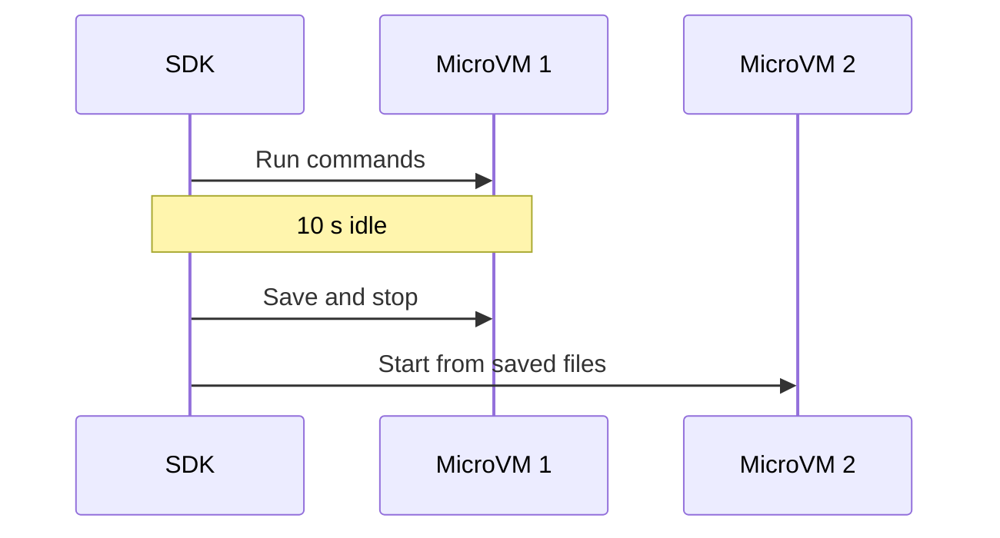
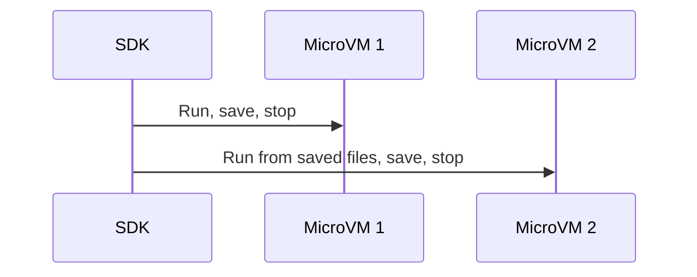

# Your first sandbox

A `sandbox_session` gives you five tools: `run`, `read_file`, `write_file`,
`grep`, and `list_dir`. Use them together to run code and work with files.
The SDK loads your connection from environment variables or a saved profile.

## Use the five tools

Save either program as `sandbox_tools.py`. It writes a file, runs `cat`, reads
the file, finds a matching line, and lists the directory in the same session.

::::{tab} Sync

<!-- name: test_first_command; fixtures: sandbox_tools_api, capsys -->

```python
"""Use the five sandbox tools in one session."""

from contree_sdk import create_sandbox_session


def main() -> None:
    with create_sandbox_session(image="tag:alpine:latest") as sandbox_session:
        # Write a file in the sandbox.
        sandbox_session.write_file("/work/message.txt", b"Hello from ConTree!\n")

        # Run a command and print its output.
        result = sandbox_session.run("cat", args=["/work/message.txt"])
        print(result.stdout)

        # Read the file as bytes.
        content = sandbox_session.read_file("/work/message.txt")
        print(content.decode())

        # Search file contents.
        matches = sandbox_session.grep("Hello", path="/work/message.txt")
        print(matches)

        # List the directory with file metadata.
        directory = sandbox_session.list_dir("/work")
        print(directory)


main()
```

<!--
name: test_first_command
```python
assert (
    capsys.readouterr().out
    == "Hello from ConTree!\n\nHello from ConTree!\n\n/work/message.txt:1:Hello from ConTree!\n\n-rw-r--r-- 1 root root 20 1970-01-01 00:00 message.txt\n\n"
)
client = sandbox_tools_api.sync
assert len(client.calls_for("spawn_instance")) == 1
assert len(client.calls_for("operation_subprocess_create")) == 2
assert client.calls_for("inspect_instance_download")[0].args == ("op-1", "/work/message.txt")
assert client.calls_for("inspect_instance_grep")[0].kwargs["path"] == "/work/message.txt"
assert client.calls_for("inspect_instance_list")[0].args == ("op-1", "/work")
assert len(client.calls_for("operation_subprocess_kill")) == 1
```
-->

::::

::::{tab} Async

<!-- name: test_first_command_async; fixtures: sandbox_tools_api, capsys -->

```python
import asyncio

from contree_sdk import create_sandbox_session


async def main() -> None:
    async with create_sandbox_session(image="tag:alpine:latest") as sandbox_session:
        # Write a file in the sandbox.
        await sandbox_session.write_file("/work/message.txt", b"Hello from ConTree!\n")

        # Run a command and print its output.
        result = await sandbox_session.run("cat", args=["/work/message.txt"])
        print(result.stdout)

        # Read the file as bytes.
        content = await sandbox_session.read_file("/work/message.txt")
        print(content.decode())

        # Search file contents.
        matches = await sandbox_session.grep("Hello", path="/work/message.txt")
        print(matches)

        # List the directory with file metadata.
        directory = await sandbox_session.list_dir("/work")
        print(directory)


asyncio.run(main())
```

<!--
name: test_first_command_async
```python
assert (
    capsys.readouterr().out
    == "Hello from ConTree!\n\nHello from ConTree!\n\n/work/message.txt:1:Hello from ConTree!\n\n-rw-r--r-- 1 root root 20 1970-01-01 00:00 message.txt\n\n"
)
client = sandbox_tools_api.async_client
assert len(client.calls_for("spawn_instance")) == 1
assert len(client.calls_for("operation_subprocess_create")) == 2
assert client.calls_for("inspect_instance_download")[0].args == ("op-1", "/work/message.txt")
assert client.calls_for("inspect_instance_grep")[0].kwargs["path"] == "/work/message.txt"
assert client.calls_for("inspect_instance_list")[0].args == ("op-1", "/work")
assert len(client.calls_for("operation_subprocess_kill")) == 1
```
-->

::::

Both programs print the command output, file contents, search matches, and file metadata.

`run()` returns stdout, stderr, and process status. `read_file()` returns bytes;
`write_file()` accepts bytes and creates parent directories. `grep()` and
`list_dir()` return structured results that you can print directly.
Use `print(directory)` for a detailed listing, or `directory.as_text(short=True)` for names only.

### What the default lazy session does

Without `session_type`, the factory selects `LazySession` for Sync and
`AsyncLazySession` for Async. Both have the same behavior. “Lazy” means the VM
starts when needed, and several commands can share one snapshot.



Select the lazy type explicitly and call `uptime` twice. Both calls use the same
MicroVM. These examples use your configured connection; add `profile="work"`
or the [token arguments below](#create-a-session-from-a-token) when needed.

::::{tab} Sync

<!--
name: test_explicit_lazy_uptime; fixtures: sandbox_api, capsys
```python
sandbox_api.command("up 1 minute\n")
```
-->

```python
from contree_sdk import LazySession, create_sandbox_session


with create_sandbox_session(
    image="tag:alpine:latest",
    session_type=LazySession,
) as session:
    print(session.run("uptime").stdout)
    print(session.run("uptime").stdout)
```

<!--
name: test_explicit_lazy_uptime
```python
client = sandbox_api.sync
assert len(client.calls_for("spawn_instance")) == 1
assert [call.args[1] for call in client.calls_for("operation_subprocess_create")] == ["uptime", "uptime"]
assert capsys.readouterr().out == "up 1 minute\n\nup 1 minute\n\n"
```
-->

::::

::::{tab} Async

<!--
name: test_explicit_lazy_uptime_async; fixtures: sandbox_api, capsys
```python
sandbox_api.command("up 1 minute\n")
```
-->

```python
import asyncio

from contree_sdk import AsyncLazySession, create_sandbox_session


async def main() -> None:
    async with create_sandbox_session(
        image="tag:alpine:latest",
        session_type=AsyncLazySession,
    ) as session:
        print((await session.run("uptime")).stdout)
        print((await session.run("uptime")).stdout)


asyncio.run(main())
```

<!--
name: test_explicit_lazy_uptime_async
```python
client = sandbox_api.async_client
assert len(client.calls_for("spawn_instance")) == 1
assert [call.args[1] for call in client.calls_for("operation_subprocess_create")] == ["uptime", "uptime"]
assert capsys.readouterr().out == "up 1 minute\n\nup 1 minute\n\n"
```
-->

::::

Creating the session or entering its context does not start a VM. The first
`run()` or `write_file()` starts it. Later commands reuse that VM, so installed
packages, files, and running processes remain available until a snapshot.

After the last command or file request finishes, the default idle timer waits
10 seconds. It then saves the filesystem as an image and stops the VM in the
background, without another call from your code. The next command starts a new
VM from that saved image automatically. Reads, searches, and directory listings
can use the saved image without starting a VM.

A snapshot preserves files, including installed packages, but loses processes
and memory. For example, a file remains after an idle pause; a background web
server must be started again. Each VM also has a lifetime limit; see
[VM lifetime settings](advanced.md#select-the-session-class-and-components).

Normal context exit saves pending changes. An exception discards changes since
the last completed snapshot. To save after every command instead, select the
[session type shown below](#save-after-every-command).

The image tag must exist on your endpoint and provide `sleep`, `sh`, `mkdir`, and
`cat`. Replace `tag:alpine:latest` with an available image, or use {doc}`images`
to prepare one. Configure credentials in {ref}`sandbox-connection`.

## Install the SDK

These guides describe the breaking **0.5 development API** and require Python
3.10–3.14. Run the installation command from this repository checkout; the
published 0.4 package does not provide the new API.

```bash
pip install -e ".[async]"
```

For synchronous programs only, `pip install -e .` is sufficient.

## Initialize a session

Choose one connection source: pass a token and AI project, or select a saved
profile. Both paths return the same session with all five tools. The SDK creates
and closes the client for you; retries are enabled by default.

### Create a session from a token

Replace `your-token` and `your-ai-project` with your credentials. Without `url`,
the SDK uses `https://api.tokenfactory.nebius.com/sandboxes`. Pass `url=...` when
using another deployment.

::::{tab} Sync

<!-- name: test_first_command_direct; fixtures: sandbox_api, capsys -->

```python
"""Create a sandbox session from a token."""

from contree_sdk import create_sandbox_session
from contree_sdk.session import IdleSnapshotPolicy


def main() -> None:
    with create_sandbox_session(
        image="tag:alpine:latest",
        token="your-token",
        project="your-ai-project",
        session_kwargs={"snapshot_policy": IdleSnapshotPolicy(60)},
    ) as sandbox_session:
        result = sandbox_session.run("echo", args=["Hello from ConTree!"])
        print(result.stdout)


main()
```

<!--
name: test_first_command_direct
```python
from contree_client.httpx import ContreeClient

profile = ContreeClient.from_profile.call_args.args[0]
assert profile.token == "your-token"
assert profile.project == "your-ai-project"
assert profile.url == "https://api.tokenfactory.nebius.com/sandboxes"
assert capsys.readouterr().out == "Hello from ConTree!\n\n"
assert len(sandbox_api.sync.calls_for("spawn_instance")) == 1
assert len(sandbox_api.sync.calls_for("operation_subprocess_kill")) == 1
```
-->

::::

::::{tab} Async

<!-- name: test_first_command_direct_async; fixtures: sandbox_api, capsys -->

```python
import asyncio

from contree_sdk import create_sandbox_session
from contree_sdk.session import IdleSnapshotPolicy


async def main() -> None:
    async with create_sandbox_session(
        image="tag:alpine:latest",
        token="your-token",
        project="your-ai-project",
        session_kwargs={"snapshot_policy": IdleSnapshotPolicy(60)},
    ) as sandbox_session:
        result = await sandbox_session.run("echo", args=["Hello from ConTree!"])
        print(result.stdout)


asyncio.run(main())
```

<!--
name: test_first_command_direct_async
```python
from contree_client.aiohttp import ContreeAsyncClient

profile = ContreeAsyncClient.from_profile.call_args.args[0]
assert profile.token == "your-token"
assert profile.project == "your-ai-project"
assert profile.url == "https://api.tokenfactory.nebius.com/sandboxes"
assert capsys.readouterr().out == "Hello from ConTree!\n\n"
assert len(sandbox_api.async_client.calls_for("spawn_instance")) == 1
assert len(sandbox_api.async_client.calls_for("operation_subprocess_kill")) == 1
```
-->

::::

### Create a session from a saved profile

Save this file as `contree.ini` in the directory where you run the program.
Replace the token and AI project values with your credentials:

```ini
[DEFAULT]
profile = work

[profile:work]
type = iam
url = https://api.tokenfactory.nebius.com/sandboxes
token = your-token
project = your-ai-project
```

The program selects `work` from this file:

::::{tab} Sync

<!-- name: test_saved_profile; fixtures: sandbox_profile_api, capsys -->

```python
"""Create a sandbox session from a saved profile."""

from contree_sdk import create_sandbox_session
from contree_sdk.session import IdleSnapshotPolicy


def main() -> None:
    with create_sandbox_session(
        image="tag:alpine:latest",
        profile="work",
        config_path="contree.ini",
        session_kwargs={"snapshot_policy": IdleSnapshotPolicy(60)},
    ) as sandbox_session:
        result = sandbox_session.run("echo", args=["Hello from ConTree!"])
        print(result.stdout)


main()
```

<!--
name: test_saved_profile
```python
from contree_client.httpx import ContreeClient

profile = ContreeClient.from_profile.call_args.args[0]
assert profile.name == "work"
assert profile.token == "your-token"
assert profile.project == "your-ai-project"
assert profile.url == "https://api.tokenfactory.nebius.com/sandboxes"
assert capsys.readouterr().out == "Hello from ConTree!\n\n"
assert len(sandbox_profile_api.sync.calls_for("spawn_instance")) == 1
assert len(sandbox_profile_api.sync.calls_for("operation_subprocess_kill")) == 1
```
-->

::::

::::{tab} Async

<!-- name: test_saved_profile_async; fixtures: sandbox_profile_api, capsys -->

```python
import asyncio

from contree_sdk import create_sandbox_session
from contree_sdk.session import IdleSnapshotPolicy


async def main() -> None:
    async with create_sandbox_session(
        image="tag:alpine:latest",
        profile="work",
        config_path="contree.ini",
        session_kwargs={"snapshot_policy": IdleSnapshotPolicy(60)},
    ) as sandbox_session:
        result = await sandbox_session.run("echo", args=["Hello from ConTree!"])
        print(result.stdout)


asyncio.run(main())
```

<!--
name: test_saved_profile_async
```python
from contree_client.aiohttp import ContreeAsyncClient

profile = ContreeAsyncClient.from_profile.call_args.args[0]
assert profile.name == "work"
assert profile.token == "your-token"
assert profile.project == "your-ai-project"
assert profile.url == "https://api.tokenfactory.nebius.com/sandboxes"
assert capsys.readouterr().out == "Hello from ConTree!\n\n"
assert len(sandbox_profile_api.async_client.calls_for("spawn_instance")) == 1
assert len(sandbox_profile_api.async_client.calls_for("operation_subprocess_kill")) == 1
```
-->

::::

If the profile already exists in the client's standard configuration, pass only
`profile="work"` and omit `config_path`. Do not combine `profile` with `token`,
`project`, or `url`; put those values in the profile instead.

### Session options and defaults

Both examples use `session_kwargs` to set a 60-second idle interval. Omit that
argument to use the default of 10 seconds. Session constructor options belong
inside `session_kwargs`; client options such as `retry` and `timeout` belong
on the factory call.

The factory selects `LazySession` for `with` and `AsyncLazySession` for
`async with`. Set `session_type` only when selecting another class or a subclass.
Use `create_sync_sandbox_session()` or `create_async_sandbox_session()` if you
want to select the context protocol explicitly; they accept the same arguments.

Creating the context opens no connection. Entering it prepares the session;
the first command starts the VM. Normal exit saves pending file changes and
closes owned resources. An exception discards changes since the last snapshot.

SDK-created clients use `contree_client.RetryPolicy()` by default. Pass
`retry=RetryPolicy(...)` to customize it, or `retry=None` to disable retries.
A client supplied through `client=` keeps its existing retry configuration.
See {doc}`advanced` for more session options and component ownership.

### Save after every command

Select `ContreeSession` for Sync or `ContreeAsyncSession` for Async. These classes
start a separate VM for each `run()` and save its filesystem before returning.
The next command uses that saved image. You do not call `snapshot()` or wait for
an idle timeout.



Call `uptime` twice with the regular session type. Each call starts a new
MicroVM; the second uses the filesystem saved by the first. Connection arguments
are the same as in the lazy example.

::::{tab} Sync

<!--
name: test_initialize_snapshot; fixtures: doc_api, capsys
```python
doc_api.complete(stdout="up 0 minutes\n")
doc_api.complete(stdout="up 0 minutes\n")
```
-->

```python
from contree_sdk import ContreeSession, create_sandbox_session


with create_sandbox_session(
    image="tag:alpine:latest",
    session_type=ContreeSession,
) as session:
    print(session.run("uptime").stdout)
    print(session.run("uptime").stdout)
```

<!--
name: test_initialize_snapshot
```python
client = doc_api.sync
spawns = client.calls_for("spawn_instance")
assert [call.args[0] for call in spawns] == ["uptime", "uptime"]
assert [call.args[1] for call in spawns] == ["base-image", "image-1"]
assert all(call.kwargs["disposable"] is False for call in spawns)
assert not client.calls_for("operation_subprocess_create")
assert capsys.readouterr().out == "up 0 minutes\n\nup 0 minutes\n\n"
```
-->

::::

::::{tab} Async

<!--
name: test_initialize_snapshot_async; fixtures: doc_api, capsys
```python
doc_api.complete(stdout="up 0 minutes\n")
doc_api.complete(stdout="up 0 minutes\n")
```
-->

```python
import asyncio

from contree_sdk import ContreeAsyncSession, create_sandbox_session


async def main() -> None:
    async with create_sandbox_session(
        image="tag:alpine:latest",
        session_type=ContreeAsyncSession,
    ) as session:
        print((await session.run("uptime")).stdout)
        print((await session.run("uptime")).stdout)


asyncio.run(main())
```

<!--
name: test_initialize_snapshot_async
```python
client = doc_api.async_client
spawns = client.calls_for("spawn_instance")
assert [call.args[0] for call in spawns] == ["uptime", "uptime"]
assert [call.args[1] for call in spawns] == ["base-image", "image-1"]
assert all(call.kwargs["disposable"] is False for call in spawns)
assert not client.calls_for("operation_subprocess_create")
assert capsys.readouterr().out == "up 0 minutes\n\nup 0 minutes\n\n"
```
-->

::::

In the lazy example, both commands share a running VM. In this example,
the VM restarts between commands. `uptime` output is rounded, so two immediate
calls can print similar values in either mode. Files survive the restart;
processes and memory do not.

`disposable=False` is the default. Passing `disposable=True` to a command skips
saving its changes. By default, a completed operation is saved even if its
process exits with a nonzero code. Failed or cancelled operations do not advance
the session history. See {doc}`session-model` for checkpoint and error behavior.

(sandbox-connection)=

### Connection sources

Configure the endpoint URL, token, and AI project for your deployment. The
project identifies where the sandbox runs; omitting it is not a complete working
configuration.

| Setting    | Environment                              | Profile / INI | Direct factory argument |
| ---------- | ---------------------------------------- | ------------- | ----------------------- |
| Endpoint   | `CONTREE_URL`                            | `url`         | `url`                   |
| Token      | `CONTREE_TOKEN` or `NEBIUS_API_KEY`      | `token`       | `token`                 |
| AI project | `CONTREE_PROJECT` or `NEBIUS_AI_PROJECT` | `project`     | `project`               |

The SDK delegates environment parsing to contree-client.

Use exactly one explicit source:

| Source             | Arguments                                | Behavior                                                                                                |
| ------------------ | ---------------------------------------- | ------------------------------------------------------------------------------------------------------- |
| Direct credentials | `url`, `project`, `token`                | Build a regular client `Profile`. Token is required. An omitted URL uses the client's default endpoint. |
| Profile object     | `profile=profile`                        | Use that exact profile. Do not combine it with direct credentials or `config_path`.                     |
| Named profile      | `profile="work"`, optional `config_path` | Resolve that name through contree-client.                                                               |
| Explicit INI       | `config_path="config.ini"`               | Resolve the file's active profile, or the name selected by `CONTREE_PROFILE`.                           |
| Automatic          | Omit all source arguments                | Use `contree_client.profiles.from_env()`, then the client's default profile resolution.                 |

Direct credentials cannot be combined with `profile` or `config_path`.
Incomplete explicit credentials raise an error rather than falling back to ENV.
An explicit source takes priority over ENV. Without one, the environment needs
both `CONTREE_URL` and `CONTREE_TOKEN` (or `NEBIUS_API_KEY`). Provide the project
through `CONTREE_PROJECT` (or `NEBIUS_AI_PROJECT`).

For INI resolution, contree-client uses an explicit profile name, then
`CONTREE_PROFILE`, then the active profile in the file. Its default files are
`cli.ini` and `auth.ini` under `CONTREE_HOME`; `auth.ini` takes priority. Without
`CONTREE_HOME`, the client uses its XDG configuration directory. A supplied
`config_path` replaces the auth file path and can be named `config.ini`; the
client also reads `cli.ini` from the same directory.

The SDK uses credentials from the selected profile; it does not acquire or
refresh credentials itself. For a profile constructed in Python, pass a
`contree_client.profiles.Profile` as `profile=...`. The `profile_from_args()`
helper constructs this object without writing a configuration file.

Continue with {doc}`images` to import a Docker image for your sandbox.
